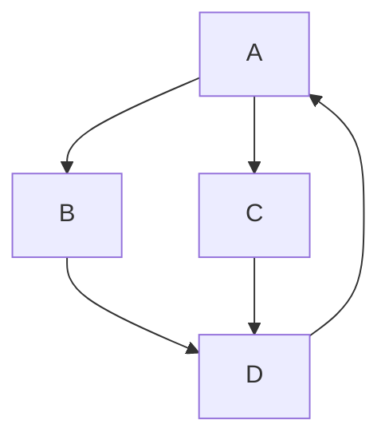
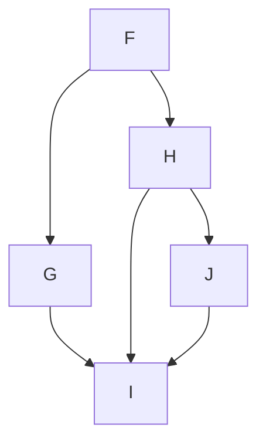
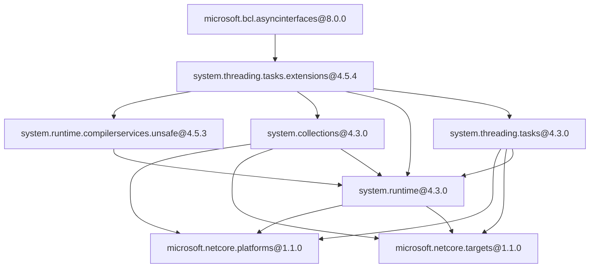

# Вариант 21. Граф зависимостей NuGet

Программа выводит настройки, прямые зависимости пакета, полный граф
зависимостей и порядок их загрузки. Граф можно получить в виде текста на
языке Mermaid, файла SVG и ASCII-дерева. Для обхода графа используется
рекурсивный BFS по уровням. Каждый пакет обрабатывается один раз, а обратные
рёбра остаются в графе.

## Установка

Нужен Python 3.9 или новее. Сборка не требуется.

```sh
python3 -m venv .venv
.venv/bin/python -m pip install -r requirements.txt
```

## Запуск

```sh
./run.sh 1
./run.sh 2
./run.sh 3
./run.sh 3 config-test.yml
./run.sh 4
./run.sh 4 config-test.yml
./run.sh 5
./run.sh 5 config-test.yml
```

- Этап 1 проверяет и печатает шесть параметров конфига.
- Этап 2 скачивает `.nuspec` указанной версии и печатает прямые зависимости
  с их ограничениями по версиям.
- Этап 3 печатает граф в виде списка смежности. Он работает с NuGet и с
  локальным репозиторием.
- Этап 4 печатает порядок загрузки: каждый пакет стоит после всех своих
  зависимостей.
- Этап 5 печатает граф на языке Mermaid и сохраняет изображение в SVG. Если
  `ascii_tree: true`, после Mermaid печатается ASCII-дерево.

По умолчанию используется `config.yml` с пакетом
`Microsoft.Bcl.AsyncInterfaces` версии `8.0.0`. Программа берёт адрес
хранилища пакетов из индекса NuGet v3 и объединяет зависимости из всех
групп платформ. Для каждого ограничения выбирается минимальная доступная
подходящая версия. Разные версии одного пакета отображаются отдельными
вершинами.

## Настройки YAML

| Ключ | Значение |
| --- | --- |
| `package` | Имя пакета. В тестовом режиме одна заглавная латинская буква |
| `repository` | URL индекса NuGet v3 или путь к тестовому YAML относительно конфига |
| `test_mode` | `true` для локального графа, `false` для NuGet |
| `version` | Версия пакета в кавычках, например `"8.0.0"`. В тестовом графе версии не используются |
| `output_file` | Имя SVG-файла для этапа 5. Файл создаётся в папке конфига |
| `ascii_tree` | `true`, чтобы на этапе 5 дополнительно вывести ASCII-дерево |

## Тестовый репозиторий

В `tests/repository.yml` ключи обозначают пакеты, значения содержат списки
их прямых зависимостей. Команда `./run.sh 3 config-test.yml` выводит:

```text
A: B, C
B: D
C: D
D: A
```

Здесь `D` встречается на двух путях и замыкает цикл через `A`. Если в
`config-test.yml` указать пакет `E`, программа выведет вершину без
зависимостей. Для пакета `Z` появится сообщение об ошибке.

## Порядок загрузки

Порядок строится по графу из этапа 3. Сначала загружаются пакеты без
зависимостей, затем пакеты, все зависимости которых уже загружены. Внутри
одной волны сохраняется порядок обхода BFS. Если пакеты закончились, а
часть графа так и не загрузилась, значит в ней есть цикл. Тогда порядка не
существует, и программа завершается с ошибкой.

Примеры для `tests/repository.yml`, пакет задаётся в `config-test.yml`:

| Пакет | Вывод `./run.sh 4 config-test.yml` |
| --- | --- |
| `F` | `1. I`, `2. G`, `3. J`, `4. H`, `5. F` |
| `E` | `1. E` |
| `A` | `Ошибка: Цикл зависимостей, порядок загрузки не определён для: A, B, C, D` |

У `F` пакет `I` нужен сразу трём пакетам и загружается первым. `G` и `J`
зависят только от `I` и идут во второй волне, затем `H` и сам `F`.

Для `Microsoft.Bcl.AsyncInterfaces 8.0.0` из `config.yml` команда
`./run.sh 4` выводит:

```text
1. microsoft.netcore.platforms@1.1.0
2. microsoft.netcore.targets@1.1.0
3. system.runtime@4.3.0
4. system.runtime.compilerservices.unsafe@4.5.3
5. system.collections@4.3.0
6. system.threading.tasks@4.3.0
7. system.threading.tasks.extensions@4.5.4
8. microsoft.bcl.asyncinterfaces@8.0.0
```

## Сравнение с NuGet

Если установить этот пакет через NuGet в проект на .NET Framework 4.6.2 с
`packages.config`, NuGet поставит только три пакета, зависимости раньше
зависимых: `System.Runtime.CompilerServices.Unsafe 4.5.3`,
`System.Threading.Tasks.Extensions 4.5.4`, `Microsoft.Bcl.AsyncInterfaces
8.0.0`. Относительный порядок этих трёх пакетов в выводе программы такой же.
В проекте на .NET 8 останется один `Microsoft.Bcl.AsyncInterfaces`, потому
что его группа `.NETStandard2.1` пустая.

Причины расхождений:

- NuGet берёт из `.nuspec` одну группу зависимостей, ближайшую к платформе
  проекта. Программа не знает платформу и объединяет все группы. Пять
  лишних пакетов приходят из групп `.NETStandard1.0` пакетов
  `System.Threading.Tasks.Extensions` и
  `System.Runtime.CompilerServices.Unsafe`.
- NuGet оставляет одну версию каждого пакета на весь проект. Программа
  показывает разные версии одного пакета отдельными вершинами.
- В проектах с `PackageReference` команда `dotnet restore` скачивает пакеты
  параллельно, поэтому строгого порядка загрузки у неё нет. В
  `obj/project.assets.json` пакеты перечислены по алфавиту.

Совпадает выбор версии: и NuGet, и программа берут минимальную версию,
подходящую под ограничение. Циклы NuGet тоже не допускает: restore
завершается ошибкой NU1108.

## Визуализация

Этап 5 строит граф так же, как этап 3, и выводит его тремя способами.

- Mermaid. Вершины получают короткие идентификаторы `n1`, `n2` и подписи с
  именами пакетов, поэтому любые имена NuGet безопасно вставлять в Mermaid.
- SVG. Раскладку программа рассчитывает сама. Уровень вершины равен длине
  самого длинного пути к ней от корня, поэтому все рёбра, кроме рёбер
  цикла, идут сверху вниз. Длинные рёбра проходят через промежуточные точки
  на пропущенных уровнях и не задевают вершины. Вершины в строке
  упорядочены по среднему положению родителей, чтобы рёбра меньше
  пересекались. Ребро цикла огибает рисунок справа.
- ASCII-дерево. Обход в глубину от корня. Отметка `(*)` значит, что
  поддерево пакета уже показано выше. Отметка `(цикл)` значит, что пакет уже
  есть на пути от корня, и дальше дерево не раскрывается.

### Пример 1. Пакет `A` с циклом

В `config-test.yml` включено `ascii_tree`. Команда
`./run.sh 5 config-test.yml` печатает Mermaid (на GitHub блок ниже
отображается как диаграмма):



Затем ASCII-дерево и путь к файлу:

```text
A
├── B
│   └── D
│       └── A (цикл)
└── C
    └── D (*)

SVG сохранён в graph.svg
```

### Пример 2. Пакет `F` без циклов

Тот же конфиг с `package: F`:



```text
F
├── G
│   └── I
└── H
    ├── I (*)
    └── J
        └── I (*)
```

В SVG пакет `I` стоит на четвёртом уровне, потому что до него есть путь
`F → H → J → I`. Рёбра `G → I` и `H → I` обходят `J` по бокам.

### Пример 3. `Microsoft.Bcl.AsyncInterfaces 8.0.0` из NuGet

Команда `./run.sh 5` с `config.yml`:



С `ascii_tree: true` дерево выглядит так:

```text
microsoft.bcl.asyncinterfaces@8.0.0
└── system.threading.tasks.extensions@4.5.4
    ├── system.runtime.compilerservices.unsafe@4.5.3
    │   └── system.runtime@4.3.0
    │       ├── microsoft.netcore.platforms@1.1.0
    │       └── microsoft.netcore.targets@1.1.0
    ├── system.collections@4.3.0
    │   ├── microsoft.netcore.platforms@1.1.0 (*)
    │   ├── microsoft.netcore.targets@1.1.0 (*)
    │   └── system.runtime@4.3.0 (*)
    ├── system.runtime@4.3.0 (*)
    └── system.threading.tasks@4.3.0
        ├── microsoft.netcore.platforms@1.1.0 (*)
        ├── microsoft.netcore.targets@1.1.0 (*)
        └── system.runtime@4.3.0 (*)
```

## Сравнение со штатными инструментами

Готовой команды для рисования графа у NuGet нет. Ближе всего к выводу
программы такие инструменты:

- `dotnet list package --include-transitive` печатает плоский список прямых
  и транзитивных пакетов проекта с выбранными версиями. Рёбер в нём нет,
  поэтому не видно, какой пакет кого подтянул.
- `dotnet nuget why <проект> <пакет>` (.NET SDK 8.0.400 и новее) печатает
  дерево всех путей от проекта к одному пакету. Общие зависимости в нём
  повторяются на каждом пути. Программа показывает поддерево один раз и
  отмечает повторы `(*)`.
- В Visual Studio узел «Зависимости» в обозревателе решений показывает
  раскрывающееся дерево пакетов.

Причины расхождений:

- Штатные инструменты строят граф для одной целевой платформы проекта.
  Для `Microsoft.Bcl.AsyncInterfaces` на .NET Framework 4.6.2 в них будет
  три пакета, а у программы восемь, потому что она объединяет все группы
  зависимостей.
- В проекте у пакета одна версия. Программа рисует разные версии одного
  пакета отдельными вершинами.
- Циклов в штатных инструментах не бывает: NuGet не восстанавливает такие
  проекты. Программа рисует цикл обратным ребром в Mermaid и SVG и
  отметкой `(цикл)` в дереве.

## Тесты

```sh
.venv/bin/python -m unittest discover -s tests
```

Тесты проверяют все шесть настроек, разбор `.nuspec`, выбор версии,
циклы, общие зависимости, пустой граф пакета, отсутствующий пакет, порядок
загрузки, вывод Mermaid, содержимое SVG и ASCII-дерево.
Для проверки NuGet используется локальный HTTP-сервер с тестовыми файлами.
